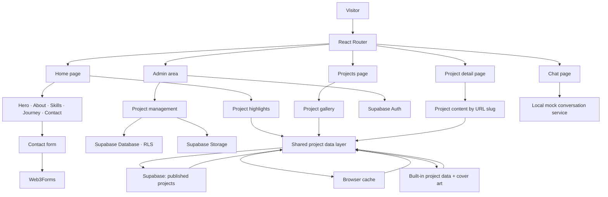

# Murali Dharan — Portfolio

A personal portfolio showcasing my work, background, skills, and ways to get in touch. The site is built with React, TypeScript, Vite, Tailwind CSS, and Framer Motion.

## How it works

The application is a client-rendered single-page site. React Router selects the home, project listing, project detail, chat, or admin view from the current URL. Shared navigation, footer, scrolling, and motion components wrap those pages.

Project content can come from Supabase or the built-in project data. When Supabase is configured, the site requests published projects, converts database rows into the shared project model, and caches the result in the browser. If Supabase is not configured or unavailable, the portfolio uses its local project list and cover artwork instead. The same project data powers the home-page highlights, full project gallery, and individual project pages.

The admin area uses Supabase authentication and project storage. Its client-side guard controls the experience; database access is enforced separately by Row Level Security policies. The contact form uses Web3Forms when configured. The chat interface currently demonstrates conversation, booking, and messaging flows with mock responses; it does not create real bookings or send chat messages.

## Architecture map

## Main areas

- `src/pages/` — Route-level home, projects, project detail, and chat views
- `src/components/` — Shared page sections, navigation, motion, contact, and project gallery components
- `src/data/` — Built-in project content, cover art, and the shared project loading and caching layer
- `src/admin/` — Supabase-backed project management interface
- `admin/` — Supabase schema and Row Level Security setup
- `public/` — Profile image and static project cover artwork
